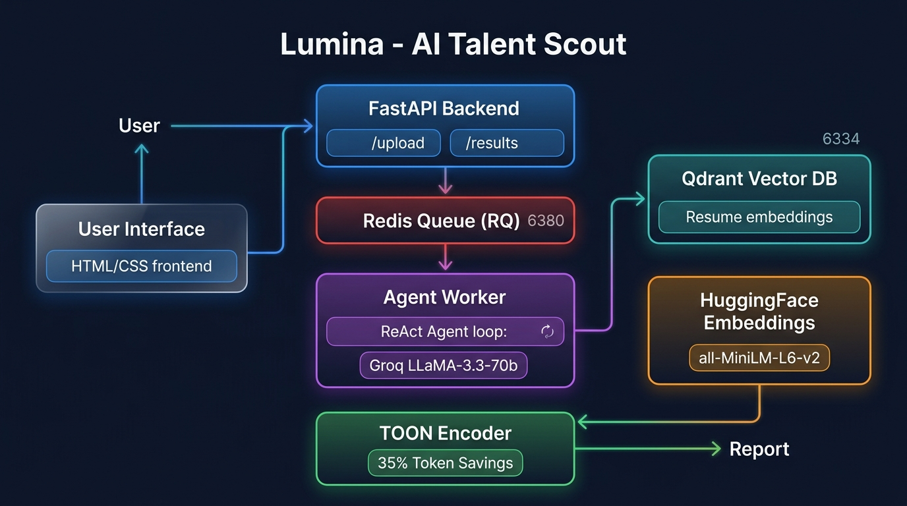
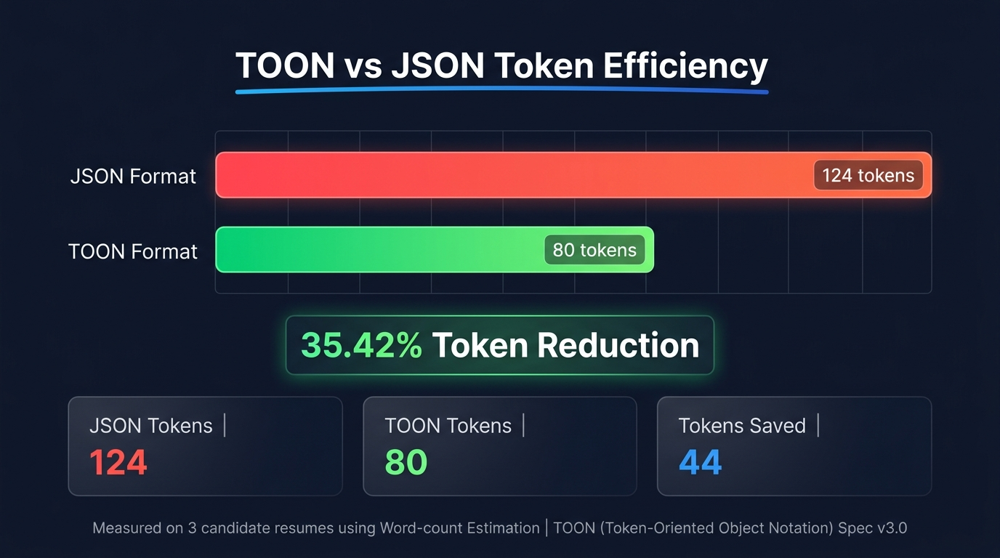

<div align="center">

# ✨ Lumina — AI Talent Scout

**An intelligent, agentic resume screening system powered by Groq LLaMA-3, Qdrant, and TOON.**

[](https://python.org)
[](https://fastapi.tiangolo.com)
[](https://groq.com)
[](https://qdrant.tech)
[](https://redis.io)
[](https://pypi.org/project/python-toon/)
[](https://docker.com)
[](LICENSE)

> Upload resumes. Drop in a job description. Lumina's ReAct agent does the rest — intelligently screening candidates using semantic search and structured reasoning.

</div>

---

## 🎯 What is Lumina?

**Lumina** is a full-stack AI recruitment assistant. You upload PDF resumes and a job description via a sleek glassmorphism web UI. Behind the scenes, a **ReAct (Reason + Act) Agent** powered by **Groq's LLaMA-3.3-70b** semantically searches an embedded vector database and produces a ranked hiring report — all asynchronously via a Redis job queue.

The secret sauce? **TOON** (Token-Oriented Object Notation) — a compact data format that reduces the tokens fed to the LLM by **35%**, making the agent faster and more cost-efficient.

---

## 🏗️ System Architecture



### How it all connects:

```
User (Browser)
    │
    ▼
FastAPI Backend  ──────►  Redis Queue (RQ)
    │                            │
    ▼                            ▼
Qdrant Vector DB  ◄─────  Agent Worker (ReAct Loop)
    │                            │
    ▼                            ▼
HuggingFace Embeddings     TOON Encoder → Hiring Report
```

---

## ⚡ TOON: Token-Oriented Object Notation

One of Lumina's key innovations is the use of **TOON** — a compact tabular serialization format — when passing resume data to the LLM. Instead of verbose JSON, TOON strips redundant structure while preserving all data.

### 📊 Token Efficiency Metrics



| Format | Token Count | Reduction |
|--------|-------------|-----------|
| **JSON** (standard) | 124 tokens | — |
| **TOON** (v3.0) | 80 tokens | **35.42% ↓** |

> *Measured on 3 mock candidate resumes using Word-count estimation. Run `scripts/compare_tokens.py` to reproduce.*

### JSON vs TOON — Side by Side

**Standard JSON (124 tokens):**
```json
[
  {
    "source": "alice_resume.pdf",
    "name": "Alice Johnson",
    "skills": "Python, Django, FastAPI, Docker, Kubernetes, AWS, PostgreSQL, Redis",
    "experience": "Senior Backend Engineer at TechCorp (5 years). Built scalable microservices.",
    "education": "BS Computer Science, MIT"
  }
]
```

**TOON Format (80 tokens):**
```
resumes[3,]{source,name,skills,experience,education}:
  alice_resume.pdf,Alice Johnson,"Python, Django, FastAPI, Docker, Kubernetes, AWS, PostgreSQL, Redis",Senior Backend Engineer at TechCorp (5 years). Built scalable microservices.,"BS Computer Science, MIT"
  bob_resume.pdf,Bob Smith,"JavaScript, React, Node.js, TypeScript, MongoDB, GraphQL, AWS Lambda",Frontend Developer at WebSolutions (3 years). Redesigned main dashboard.,"BS Information Technology, GT"
  charlie_resume.pdf,Charlie Davis,"Java, Spring Boot, Hibernate, MySQL, Kafka, Jenkins, CI/CD",Software Engineer at EnterpriseDev (4 years). Optimized payment processing.,"MS Computer Science, Stanford"
```

> TOON eliminates repeated key names — the biggest source of token bloat in JSON — making it ideal for structured LLM tool outputs.

---

## 🧠 ReAct Agent Loop

Lumina uses a **ReAct (Reasoning + Acting)** agentic loop with structured JSON output. The agent runs up to 5 cycles:

```
PLAN  → Analyze the job description
  ↓
TOOL  → Call search_resumes("relevant skill query")
  ↓
OUTPUT → Generate ranked hiring report
```

Each step produces a structured JSON object:
```json
{
  "step": "TOOL",
  "tool": "search_resumes",
  "input": "Python backend engineer with 5+ years experience"
}
```

The tool result is returned as **TOON**, which the agent then uses to write the final structured report.

---

## 🗂️ Project Structure

```
lumina/
├── main.py                  # FastAPI app — /upload & /results endpoints
├── core/
│   └── agent_worker.py      # 🧠 ReAct Agent, PDF ingestion, TOON encoding
├── config/
│   └── redis_config.py      # Redis Queue configuration
├── static/
│   └── index.html           # Glassmorphism frontend UI
├── scripts/
│   └── compare_tokens.py    # TOON vs JSON token benchmarking script
├── assets/
│   ├── architecture.jpg     # System architecture diagram
│   └── toon_metrics.jpg     # Token efficiency visualization
├── docker-compose.yml       # Qdrant + Redis services
├── requirements.txt         # Python dependencies
└── .env                     # API keys (not committed)
```

---

## 🛠️ Tech Stack

| Layer | Technology |
|-------|-----------|
| **LLM** | Groq — LLaMA-3.3-70b-versatile |
| **Agent Pattern** | ReAct (Reason + Act) |
| **Vector DB** | Qdrant (via Docker) |
| **Embeddings** | `sentence-transformers/all-MiniLM-L6-v2` (local) |
| **Job Queue** | Redis + RQ (Redis Queue) |
| **Backend** | FastAPI + Uvicorn |
| **Data Format** | TOON (Token-Oriented Object Notation) |
| **PDF Parsing** | pypdf |
| **Frontend** | Vanilla HTML/CSS (Glassmorphism) |
| **Containerization** | Docker Compose |

---

## 🚀 Getting Started

### Prerequisites

- Python 3.10+
- Docker & Docker Compose
- A [Groq API key](https://console.groq.com) (free tier available)

### 1. Clone the Repository

```bash
git clone https://github.com/prithamnandavaram/lumina.git
cd lumina
```

### 2. Set Up Environment Variables

Create a `.env` file:
```env
GROQ_API_KEY=your_groq_api_key_here
QDRANT_URL=http://localhost:6334
```

### 3. Install Python Dependencies

```bash
python -m venv venv
source venv/bin/activate   # Windows: venv\Scripts\activate
pip install -r requirements.txt
```

### 4. Start Infrastructure (Docker)

Starts Qdrant (Vector DB) and Redis (Queue) on non-conflicting ports:

```bash
docker-compose up -d
```

| Service | Container Port | Host Port |
|---------|---------------|-----------|
| Qdrant | 6333 | **6334** |
| Redis | 6379 | **6380** |

### 5. Start the RQ Worker — Terminal 1

*(Run from the **parent** directory of `lumina/`)*

```bash
cd ..
./lumina/venv/bin/rq worker \
  --worker-class rq.SimpleWorker \
  --url redis://localhost:6380 \
  default
```

### 6. Start the API Server — Terminal 2

*(Run from the **parent** directory of `lumina/`)*

```bash
cd ..
./lumina/venv/bin/uvicorn lumina.main:app --reload --port 8001
```

### 7. Open the App 🎉

Visit: **http://localhost:8001/static/index.html**

---

## 📡 API Reference

### `POST /upload`

Upload resumes and queue the AI analysis.

**Request:** `multipart/form-data`

| Field | Type | Description |
|-------|------|-------------|
| `job_description` | string | The job description text |
| `resumes` | File[] | One or more PDF resume files |

**Response:**
```json
{
  "status": "Resumes Processed & Report Generation Queued",
  "processed_count": 3,
  "job_id": "abc-123-xyz"
}
```

### `GET /results/{job_id}`

Poll for the hiring report.

| Status | Meaning |
|--------|---------|
| `processing` | Agent is still working |
| `finished` | Report is ready |
| `failed` | An error occurred |

**Response (finished):**
```json
{
  "status": "finished",
  "report": "## Hiring Report\n\n**Top Candidate: Alice Johnson**..."
}
```

---

## 📐 Code Reading Guide

New to the project? Read files in this order:

| # | File | Why |
|---|------|-----|
| 1 | `config/redis_config.py` | Simplest file. Sets up the job queue. |
| 2 | `core/agent_worker.py` | The brain — PDF ingestion, embedding, TOON encoding, ReAct loop. |
| 3 | `main.py` | API layer connecting the brain to the outside world. |
| 4 | `static/index.html` | The frontend UI. |
| 5 | `scripts/compare_tokens.py` | Run to see TOON token savings live. |

---

## 🧪 Reproducing the TOON Benchmark

```bash
cd lumina
./venv/bin/python scripts/compare_tokens.py
```

**Expected output:**
```
--- Token Comparison Analysis ---
Tokenizer used: Word-count Estimate
Dataset: 3 mock resumes

JSON Tokens:  124
TOON Tokens:  80
Savings:      44 tokens
Efficiency:   35.42% reduction
```

---

## 🌐 How TOON Is Used in the Agent

In `core/agent_worker.py`, the `search_resumes()` tool returns TOON instead of JSON:

```python
from toon import encode as toon_encode

def search_resumes(query: str):
    results = vector_store.similarity_search(query, k=3)
    data = [{"source": r.metadata["source"], "snippet": r.page_content[:400]} for r in results]
    return toon_encode({"resumes": data})  # ← TOON, not JSON
```

The LLM's system prompt teaches it to read TOON format, and it natively interprets the compact tabular output.

---

## 🔮 Future Improvements

- [ ] Queue each resume ingestion as a separate RQ job (true parallel processing)
- [ ] Add GPT-2 tokenizer for precise BPE token benchmarking
- [ ] Persist hiring reports to a database
- [ ] Add API authentication
- [ ] Support DOCX resume formats
- [ ] Multi-turn conversation with the agent
- [ ] Export reports to PDF

---

## 📄 License

MIT License — see [LICENSE](LICENSE) for details.

---

<div align="center">

Built with ❤️ by [Pritham Nandavaram](https://github.com/prithamnandavaram)

**Lumina** — *Light on your token budget. Bright on insights.*

</div>
